  

# 🌐 Awesome Federated Metadata & Global Search

### Curated Collection of Enterprise Search Engines, Cross-Silo Federated Query Systems & Unified Metadata Catalogs

  
  
  
  
  
  

  <b>🔍 Query everywhere. 🔒 Move nothing. ⚡ Unify enterprise knowledge with permission fidelity.</b>

---

A comprehensive, production-tested curated list of **SaaS platforms**, **open-source federated search engines**, **metadata catalogs**, and **cross-silo query protocols**. Designed for IT architects, search engineers, enterprise knowledge managers, and data platform leads building workplace search and RAG retrieval pipelines without moving sensitive data into a single centralized silo.

> [!NOTE]
> **Federated Search vs. Centralized Indexing**: Federated search queries native APIs where files live, preserving real-time freshness and source ACLs. Centralized enterprise search engines crawl and vectorize documents into a unified index for sub-second lexical/vector hybrid retrieval.

---

## 📑 Table of Contents
- [📊 Sector Overview & Market Dynamics](#-sector-overview--market-dynamics)
- [☁️ SaaS & Hosted Platforms](#️-saas--hosted-platforms)
- [💻 Open-Source GitHub Projects](#-open-source-github-projects)
- [🤝 How to Contribute](#-how-to-contribute)
- [💖 Support & Community](#-support--community)
- [⚠️ Disclaimer](#️-disclaimer)
- [📈 Star History](#-star-history)

---

## 📊 Sector Overview & Market Dynamics

The enterprise search and metadata federation market is valued at approximately **$5.5B–$6.7B** globally and is projected to cross **$12B+** by the early 2030s (growing at ~8–9% CAGR). 

The market exhibits a **bifurcated structure**:
- **Workplace Productivity Layer (Moderately Concentrated / Winner-Take-Most)**: Dominated by hyperscaler productivity bundles (Microsoft 365 Copilot / Graph and Google Cloud Search / Workspace) and breakout AI search leaders like Glean.
- **Enterprise Core & Cross-Silo Federation (Highly Fragmented)**: Governed by diverse legacy architectures, on-premises systems (SAP, Jira, Confluence, Documentum, mainframe repositories), multi-cloud lakes (Snowflake, BigQuery, S3), and strict data-sovereignty mandates where zero-data-movement federated query engines (Swirl, Trino) and self-hosted open-source search platforms (Elasticsearch, OpenSearch, Vespa, DataHub) are essential.

---

## ☁️ SaaS & Hosted Platforms

Enterprise SaaS platforms that unify fragmented company tools into a single conversational or search interface.

| Product | Company Size (Valuation / Revenue) | Description | Pricing (Starting) | Free Tier / Trial Limits |
|---------|-----------------------------------|-------------|-------------------|--------------------------|
| **[AWS Kendra](https://aws.amazon.com/kendra/)** | **~$600B–$1T implied valuation** ($128.7B+ annual revenue, AWS segment of Amazon) | Managed enterprise cognitive search powered by machine learning and NLP. *(Note: End of support for new customer sign-ups begins July 30, 2026; existing customers retain ongoing service).* | **$0.32/hour** (~$230.40/month) base capacity unit for GenAI Enterprise Edition; Developer Edition starts at $1.125/hour (~$810/month). | **750 hours free for first 30 days** across Developer/GenAI editions (1 base unit up to 1,000 rescored queries/day; connector sync time billed separately). No new signups after July 2026. |
| **[Glean](https://www.glean.com/)** | **$4.6B valuation** (~$90M+ estimated ARR) | **The enterprise search and workplace AI assistant standard.** 100+ native SaaS connectors (Slack, Google Drive, Jira, Notion, GitHub) with query-time **permission ACL inheritance** and enterprise RAG synthesis. | **$45–$75/user/month** (annual agreement; starting contract minimum floor is typically **$50,000–$60,000/year** with 50–100 seat minimums). | **No permanent free tier and no self-serve free trial**; evaluation is conducted via custom sales demos and paid Proof-of-Concept (POC) engagements. |
| **[Coveo](https://www.coveo.com/)** | **~$440M CAD (~$320M USD) market cap** (TSX: CVO, $148.3M USD FY2026 revenue) | **AI search, customer support, and digital commerce discovery leader.** Relevance Cloud platform featuring unified hybrid search, automatic query tuning, and deep Salesforce/ServiceNow connectors. | **$600/month** ($7,200/year billed annually) historical baseline plan; production enterprise deployments typically start around **$28,000–$50,000/year**. | **14-day free trial** with access to select cloud connectors and machine learning relevance models for prototyping (no credit card required). No permanent free tier. |
| **[Lucidworks Fusion](https://www.lucidworks.com/)** | **~$326M valuation** ($270M–$370M peak private valuation, ~$41M–$47M estimated annual revenue) | **Enterprise-grade commerce and workplace search platform.** Built upon Apache Solr with a proprietary commercial AI/ML orchestration layer and analytics studio. | **$28,000/year** average starting annual contract value on B2B procurement benchmarks (scaling to $79,000+/year based on node capacity and query throughput). | **30-day evaluation trial** available for containerized or self-hosted sandbox setups via sales consultation (14-day extension modules; config locks on expiration). No perpetual free tier. |
| **[Sinequa](https://www.sinequa.com/)** | **~$40M–$43M annual revenue** (part of ChapsVision, €200M group revenue) | **Cognitive search for highly regulated industries** (pharmaceuticals, aerospace, banking). 200+ out-of-the-box enterprise connectors, neural search, and high-fidelity ACL security trimming. | **$60,000–$100,000/year** starting enterprise contract floor based on deployed Search-Based Applications (SBAs) and indexed corpus volume (large deployments scale to $1M–$3M/year). | **No perpetual free tier and no public self-serve trial**; evaluation is available via structured multi-week Proof-of-Concept (PoC) pilot programs arranged through sales. |

---

## 💻 Open-Source GitHub Projects

Self-hosted enterprise search engines, federated query coordinators, and cross-silo metadata platforms. 

> Sorted by GitHub stargazers count (descending):

| Project | Star Badge | Description | Primary Use Case |
|---------|:----------:|-------------|------------------|
| **[Elasticsearch](https://github.com/elastic/elasticsearch)** |  | Distributed, multitenant-capable full-text and vector search engine with JSON REST APIs, ELK stack integration, and HNSW vector indexing. | Enterprise search, log analytics & hybrid retrieval backbone |
| **[Meilisearch](https://github.com/meilisearch/meilisearch)** |  | Lightning-fast, hyper-relevant, typo-tolerant search engine written in Rust. Features out-of-the-box prefix search, hybrid search, and intuitive SDKs. | Front-end application search & instant typo-tolerant site search |
| **[SearXNG](https://github.com/searxng/searxng)** |  | Privacy-respecting, self-hosted metasearch engine that aggregates and federates queries across 70+ search services without tracking users. | Privacy-first self-hosted web and organizational metasearch |
| **[Qdrant](https://github.com/qdrant/qdrant)** |  | High-performance vector database and similarity search engine written in Rust with extended payload-based metadata filtering. | High-throughput vector search & metadata-filtered retrieval for RAG |
| **[Onyx](https://github.com/onyx-dot-app/onyx)** |  | Open-source enterprise search and workplace AI assistant (formerly Danswer). Directly connects to Google Drive, Slack, Confluence, Jira, and GitHub with document-level access control. | Self-hosted Glean alternative with turn-key workplace connectors & GenAI chat |
| **[OpenMetadata](https://github.com/open-metadata/OpenMetadata)** |  | Unified metadata platform featuring end-to-end data discovery, automated lineage, data quality profiler, and central enterprise governance with open metadata standards. | Cross-silo enterprise metadata catalog, data discovery & governance |
| **[OpenSearch](https://github.com/opensearch-project/OpenSearch)** |  | Community-driven, Apache-2.0 open-source search and analytics suite forked from Elasticsearch 7.10.2. Maintained under the Linux Foundation with OpenSearch Dashboards. | Vendor-neutral enterprise search, distributed indexing & log analytics |
| **[Trino](https://github.com/trinodb/trino)** |  | Fast distributed SQL query engine for federated queries against heterogeneous data sources (PostgreSQL, MySQL, S3, Hive, BigQuery, Kafka, Snowflake) without copying data. | Federated cross-database query engine & data lake SQL search |
| **[DataHub](https://github.com/datahub-project/datahub)** |  | The extensible metadata platform originally built at LinkedIn. Real-time stream-based architecture powering federated enterprise metadata search, graph lineage, and governance. | Global metadata search & enterprise data mesh catalog |
| **[Vespa](https://github.com/vespa-engine/vespa)** |  | High-throughput distributed search, vector retrieval, and real-time tensor computation engine developed by Yahoo. Powers low-latency hybrid BM25 and vector ranking at massive scale. | Large-scale semantic search, AI vector serving & hybrid ranking |
| **[Amundsen](https://github.com/amundsen-io/amundsen)** |  | Metadata driven application created at Lyft for data discovery, data asset indexing, and enterprise-wide knowledge curation. | Enterprise data portal & metadata search for analytics teams |
| **[Apache Lucene](https://github.com/apache/lucene)** |  | The foundational high-performance, full-featured search library written in Java powering Elasticsearch, Solr, and modern vector extensions. | Core indexing & inverted search library |
| **[Swirl](https://github.com/swirlai/swirl-search)** |  | **Purpose-built open-source federated search engine.** Queries 100+ native APIs (SharePoint, Jira, Salesforce, Slack, databases, Elasticsearch) without moving data, re-ranking unified results with cosine similarity and LLM extractors. | True federated zero-data-movement enterprise query engine |
| **[Apache Solr](https://github.com/apache/solr)** |  | The battle-tested Apache enterprise search platform built on Lucene. SolrCloud clustering, advanced faceting, rich document handling (Tika), and dense vector indexing. | Self-managed enterprise search infrastructure & document faceting |
| **[Datafari](https://github.com/francelabs/datafari)** |  | French open-source enterprise search solution combining Apache Solr, Apache ManifoldCF, and OCR extraction. Optimized for GDPR compliance and sovereign European enterprise deployments. | Self-hosted European sovereign workplace search |
| **[Turing ES](https://github.com/openviglet/turing)** |  | Open-source enterprise search and Generative AI platform (Algolia/Coveo alternative). Multi-engine abstraction layer over Solr, Elasticsearch, and Lucene with RAG chat and MCP servers. | Free Algolia/Coveo alternative with integrated RAG chat & AI agents |

---

## 🤝 How to Contribute

We welcome community contributions, new project submissions, and corrections!

1. 🍴 **Fork** this repository.
2. 🌿 **Create a branch** for your updates (`git checkout -b feature/add-new-search-tool`).
3. ✍️ **Add or edit** entries in [README.md](file:///C:/Users/ishan/Documents/Projects/Awesome-Federated-Metadata-Global-Search/README.md) following the existing Markdown table format:
   - Provide the exact GitHub link and project name.
   - Include the `` star badge.
   - Add a concise, factual description with primary use cases and pricing transparency.
4. 🚀 **Submit a Pull Request** with a descriptive summary of your changes.

---

## 💖 Support & Community

If you find this curated collection useful for your architecture research or open-source stack, consider showing your support:

- ⭐ **Star this repository** to help other architects, developers, and data engineers discover it.
- 🍴 **Fork it** and build your team's internal enterprise search evaluation guide.
- 📢 **Share** with your engineering network on LinkedIn, X, or Discord.
- ☕ **Sponsor & Buy a Coffee**: Support ongoing maintenance and curated ecosystem research via the [GitHub Sponsor Dashboard](https://github.com/sponsors/ishandutta2007).

---

## ⚠️ Disclaimer

- This is a community-curated directory intended for research, evaluation, and educational purposes. Inclusion does not imply commercial sponsorship or endorsement.
- **Enterprise Permission Fidelity**: Querying cross-silo internal data demands rigorous ACL verification. Always ensure the search layer enforces source-level access control permissions at query time rather than leaking confidential internal data across department boundaries.
- **Service Lifecycles & Pricing**: Pricing and commercial plans change over time. Verify current tiers and SLAs directly with software vendors prior to production procurement.

---

## 📈 Star History

---

Made with ❤️ for IT architects, knowledge managers, and data engineers building open and sovereign search infrastructure.

